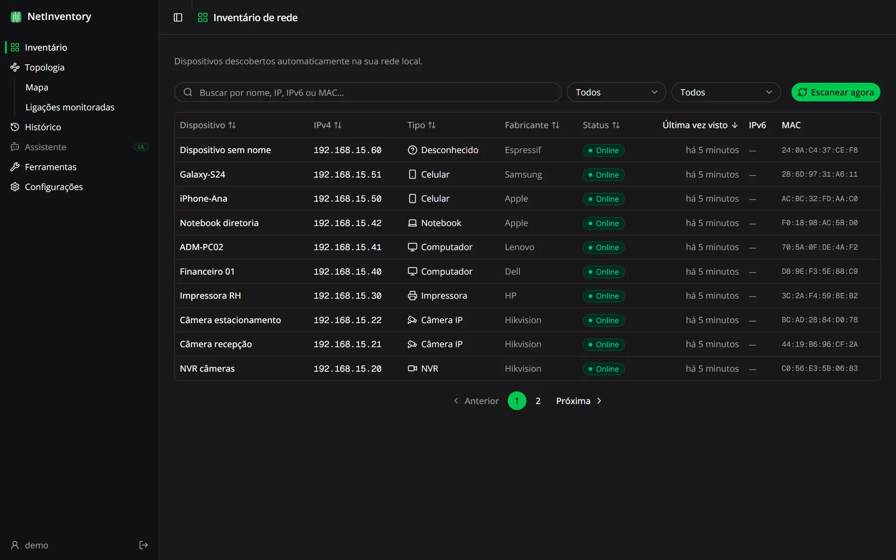
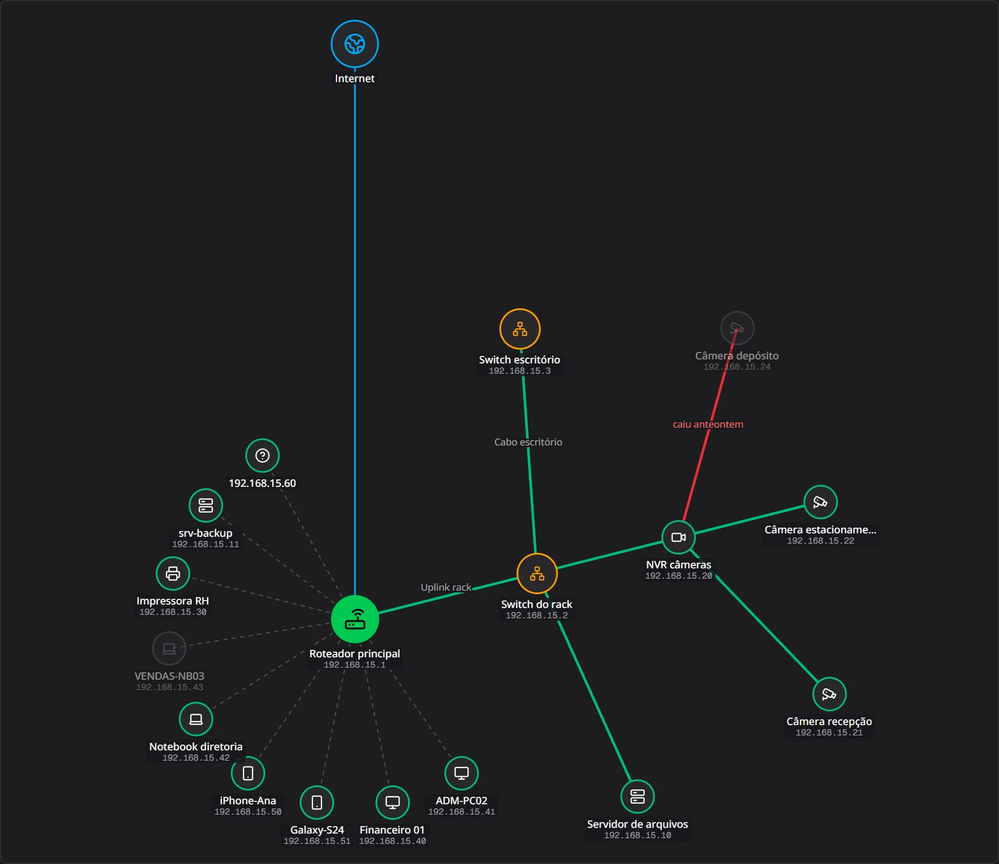
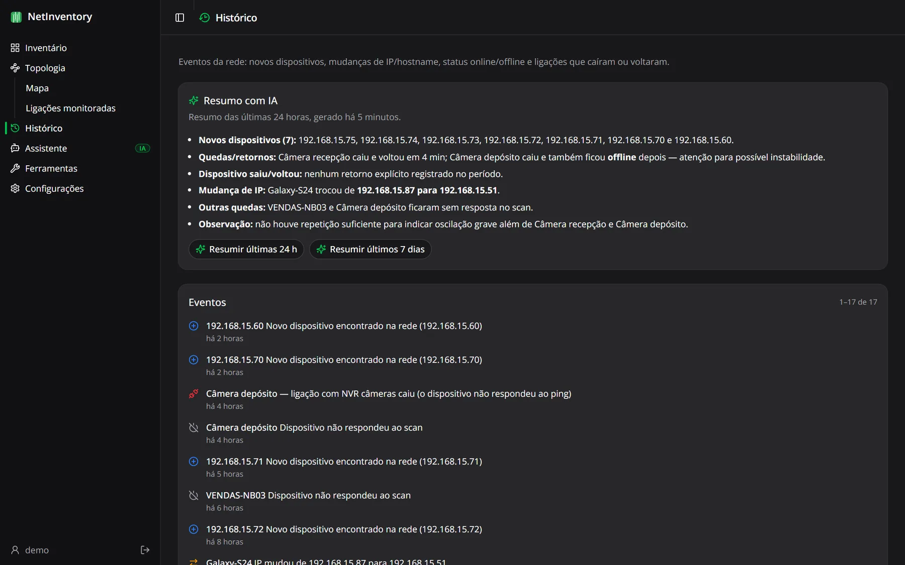
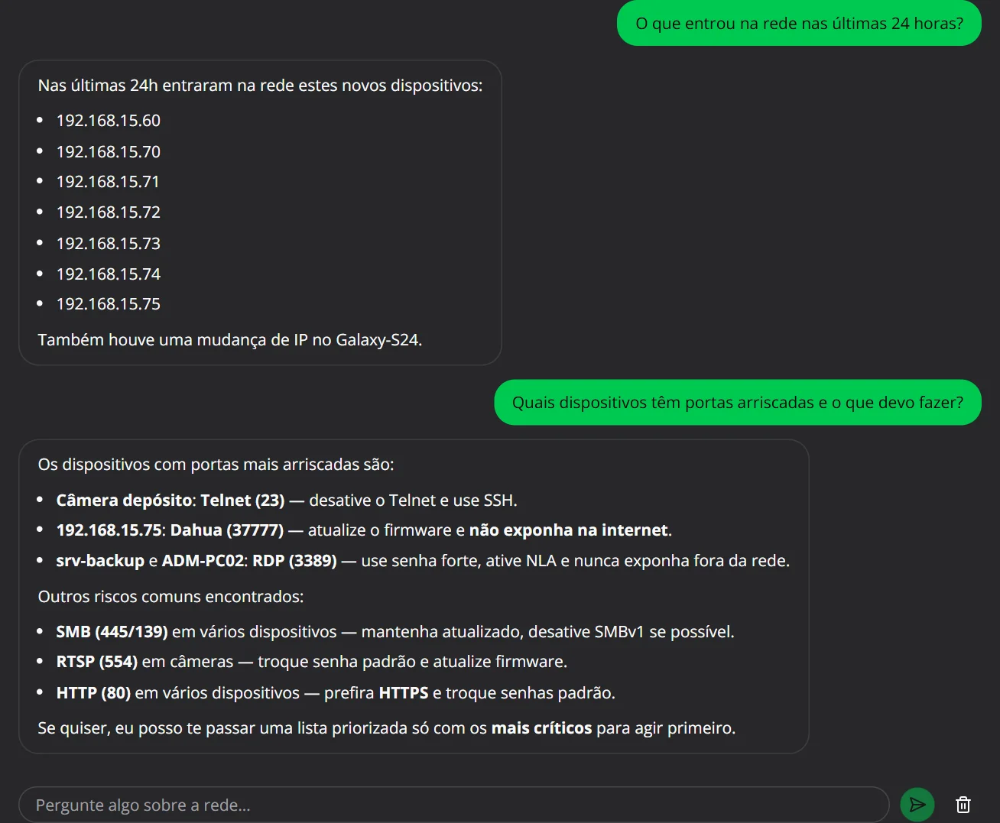
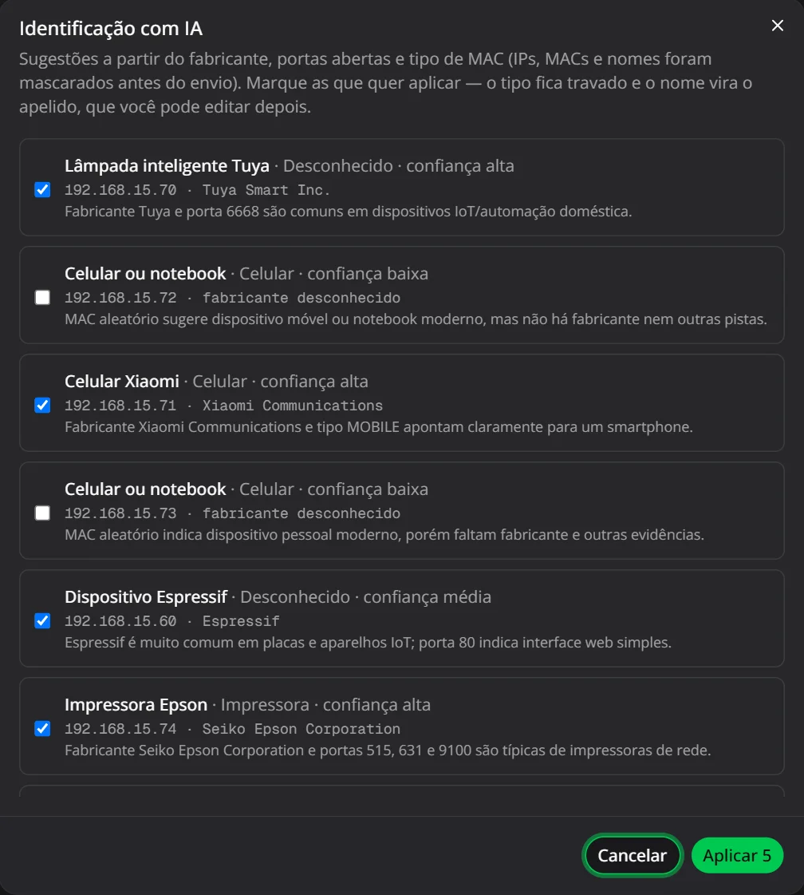
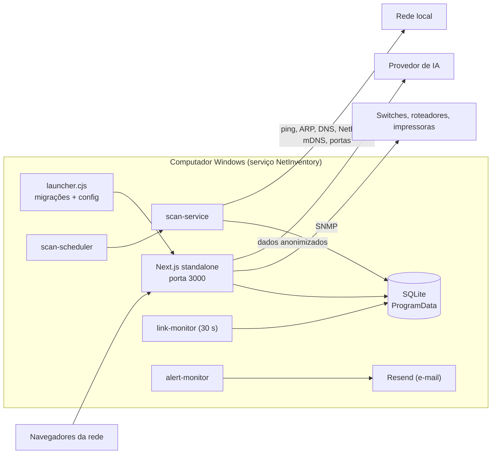

<p align="center">
  
</p>

<h1 align="center">NetInventory</h1>

<p align="center">
  <strong>Inventário, mapa e monitoramento da rede local, com um assistente de IA que entende a sua rede.</strong><br>
  Gratuito, em português e instalado em 1 minuto no Windows.
</p>

<p align="center">
  <a href="https://github.com/CFSJCODE/net-inventory-ia/releases/latest"></a>
  <a href="https://github.com/CFSJCODE/net-inventory-ia/releases"></a>
  <a href="https://github.com/CFSJCODE/net-inventory-ia/actions/workflows/release.yml"></a>
  <a href="https://github.com/CFSJCODE/net-inventory-ia/commits/main"></a>
  <a href="LICENSE"></a>
</p>

<p align="center">
  
  
  
  
  
  
  
  
  
  
</p>

<p align="center"><em>Local network inventory, topology map, SNMP equipment and link monitoring with an AI assistant — free and open source.</em></p>



## Sumário

- [Download do agente para Windows (.exe)](#download-do-agente-para-windows-exe)
- [O que ele faz](#o-que-ele-faz)
- [Telas e funcionalidades](#telas-e-funcionalidades)
- [A IA trabalhando na administração da rede](#a-ia-trabalhando-na-administração-da-rede)
- [Instalação (Windows)](#instalação-windows)
- [Perfis de acesso](#perfis-de-acesso)
- [Como funciona por dentro](#como-funciona-por-dentro)
- [Desenvolvimento](#desenvolvimento)
- [Gerar e publicar o instalador](#gerar-e-publicar-o-instalador)
- [Limitações conhecidas](#limitações-conhecidas)
- [Licença e autor](#licença-e-autor)

## Download do agente para Windows (.exe)

O instalador **não fica versionado no Git** (as pastas `installer/output/` e `installer/dist/` estão no `.gitignore`). Ele é gerado pelo workflow [`release.yml`](.github/workflows/release.yml) a cada tag `v*` e publicado como anexo da Release no GitHub.

| Versão atual | Arquivo | Tamanho | SHA-256 |
|---|---|---|---|
| [v0.2.10](https://github.com/CFSJCODE/net-inventory-ia/releases/tag/v0.2.10) | [`NetInventory-Setup-0.2.10.exe`](https://github.com/CFSJCODE/net-inventory-ia/releases/download/v0.2.10/NetInventory-Setup-0.2.10.exe) | 43 MB | `eac8ec36032ef1105dba1aad3b0ade1f0f725af360e2d011ca78aaa92974f383` |

Confira o hash antes de instalar (PowerShell):

```powershell
Get-FileHash .\NetInventory-Setup-0.2.10.exe -Algorithm SHA256
```

Versões anteriores ficam em [Releases](https://github.com/CFSJCODE/net-inventory-ia/releases).

## O que ele faz

O NetInventory roda como serviço em um computador da sua rede e mostra, num painel web acessível de qualquer navegador da rede:

- **Inventário automático**: scans manuais ou agendados (5, 15, 30 ou 60 minutos) descobrem cada dispositivo com IPv4, IPv6, MAC, fabricante, hostname e portas abertas, e classificam o tipo (computador, notebook, celular, impressora, câmera, DVR/NVR, switch, roteador, servidor, Smart TV, IoT).
- **Equipamentos SNMP**: cadastro de switches, roteadores e impressoras gerenciáveis com SNMP v1, v2c ou v3 (MD5/SHA). Mostra CPU, memória, temperatura, ventoinhas, fontes, estado de cada porta e, nas impressoras, os suprimentos (Printer-MIB).
- **Mapa da topologia**: a rede desenhada a partir do gateway, com descoberta de ligações reais via SNMP (tabela de MACs do switch) e posições que você arrasta e ficam salvas.
- **Ligações monitoradas**: cada link importante é testado a cada 30 segundos e só é declarado caído após 2 falhas seguidas; caiu, fica vermelho no mapa e vai para o histórico.
- **Histórico e alertas**: dispositivos novos, mudanças de IP e hostname, quedas e retornos, com notificações no navegador e alertas por e-mail (Resend) para equipamento fora do ar, desempenho degradado e CPU, memória ou temperatura acima do limite.
- **Regras de IP**: classifique endereços por tipo (IP único, faixa, CIDR ou curinga) e ignore IPs que só geram ruído no histórico.
- **Ferramentas de rede**: ARP scan, port scan, SNMP, Wake-on-LAN, DHCP, DNS, tabela ARP, tabela de rotas e auditoria de segurança.
- **Usuários e perfis**: Administrador, Operador e Visualizador, cada pessoa com o acesso certo.

| Topologia | Histórico com resumo da IA |
|---|---|
|  |  |

## Telas e funcionalidades

| Tela | Rota | O que faz | Implementação |
|---|---|---|---|
| Inventário | `/` | Lista, filtra e ordena os dispositivos; dispara o scan; identificação em lote com IA | `src/components/device-inventory.tsx`, `device-table.tsx`, `device-filters.tsx` |
| Dispositivo | `/devices/[id]` | Detalhes, portas, identidade (nome, tipo, uplink) e diagnóstico de segurança com IA | `src/components/device-identity-card.tsx`, `ai/device-security-card.tsx` |
| Equipamentos | `/equipment` | Cadastro SNMP e leitura automática no intervalo escolhido | `src/components/equipment/`, `src/lib/network/equipment-status.ts` |
| Detalhe do equipamento | `/equipment/[id]` | Hardware, portas em tempo real e suprimentos de impressora | `equipment-status-panel.tsx`, `port-popover.tsx` |
| Topologia | `/topology` | Mapa arrastável com ligações descobertas ou presumidas | `src/components/topology/topology-view.tsx`, `src/lib/topology-layout.ts` |
| Ligações | `/topology/links` | Links monitorados, latência e estado | `topology/links-panel.tsx`, `src/lib/network/link-monitor.ts` |
| Histórico | `/history` | Linha do tempo de eventos com resumo de 24 h ou 7 dias pela IA | `ai/ai-summary-card.tsx`, modelo `DeviceEvent` |
| Assistente | `/assistant` | Chat em português que consulta inventário, histórico e ligações | `ai/assistant-chat.tsx`, `src/lib/ai/features.ts` |
| Ferramentas | `/tools` | ARP scan, port scan, SNMP, WoL, DHCP, DNS, ARP, rotas e auditoria | `src/components/tools/`, `src/lib/network/tools/` |
| Configurações | `/settings` | Faixa e agenda do scan, regras e IPs ignorados, IA, e-mails de alerta, limpeza | `settings-form.tsx`, `ip-rules-card.tsx`, `ignored-ips-card.tsx`, `email-alerts-card.tsx` |
| Usuários | `/users` | Criar, desativar, mudar perfil e redefinir senha | `src/components/users/users-manager.tsx` |
| Minha conta | `/account` | Troca da própria senha | `account/change-password-card.tsx` |

## A IA trabalhando na administração da rede

A IA é opcional e configurada pela interface, em **Configurações**. Provedores suportados ([`src/lib/ai/providers.ts`](src/lib/ai/providers.ts)):

| Provedor | Observação |
|---|---|
| Google Gemini | Modelos gratuitos pelo Google AI Studio |
| OpenRouter | Modelos `:free` (Llama, DeepSeek, Qwen, Gemini) |
| Groq | Llama 3 com resposta muito rápida |
| Ollama | IA local, sem internet e sem chave |
| OpenAI | GPT-4o Mini, GPT-4o e família GPT-5 |
| Personalizado | Qualquer servidor compatível com a API da OpenAI (LM Studio, LocalAI, vLLM…) |

Com ela, o NetInventory ganha um analista de rede:

- **Assistente em português**: "o que entrou na rede nas últimas 24 horas?", "quais dispositivos têm portas arriscadas?". Ele consulta inventário, histórico e ligações (function calling) antes de responder.
- **Identificação de dispositivos**: sugere nome e tipo para aparelhos desconhecidos a partir de fabricante, portas e tipo de MAC, com o nível de confiança.
- **Diagnóstico de segurança**: transforma as portas de risco da rede inteira num relatório priorizado com as ações a tomar.
- **Resumo de eventos**: as últimas 24 horas ou 7 dias em poucas linhas.

| Assistente | Identificação com IA |
|---|---|
|  |  |

**Privacidade:** IPs, MACs, hostnames e apelidos são substituídos por marcadores (`ip-1`, `dispositivo-1`…) **antes** de qualquer envio e restaurados na resposta ([`src/lib/ai/redact.ts`](src/lib/ai/redact.ts)). As chamadas só acontecem quando você clica e as respostas ficam em cache por 24 h ([`src/lib/ai/client.ts`](src/lib/ai/client.ts)). A chave fica criptografada (AES-256-GCM) no banco e nunca volta ao navegador.

## Instalação (Windows)

1. Baixe o instalador em **[Releases](https://github.com/CFSJCODE/net-inventory-ia/releases/latest)** e confira o SHA-256 publicado.
2. Execute num computador que fique ligado e esteja na rede que será monitorada. Sem assinatura digital, o Windows mostra o aviso do SmartScreen: **Mais informações → Executar assim mesmo**.
3. Abra `http://localhost:3000` (ou `http://IP-do-computador:3000` de outra máquina) e crie o administrador.
4. Em **Configurações → Scan da rede**, informe a faixa da sua rede. Descubra com `ipconfig`: IPv4 `192.168.0.25` e máscara `255.255.255.0` resultam em `192.168.0.0/24`.
5. Opcional: configure um provedor de IA quando o app pedir (ou em Configurações).

O instalador traz tudo embutido (Node.js, banco SQLite, migrações), registra o serviço **NetInventory** (inicia com o Windows e reinicia sozinho), cria atalhos no menu Iniciar e libera a porta 3000 no firewall para redes privadas e de domínio. Os dados ficam em `C:\ProgramData\NetInventory` (banco `netinventory.db`, `config.json` e logs) e são mantidos em atualizações.

**Atualizar:** execute o instalador da versão nova por cima da instalada.

## Perfis de acesso

| | Administrador | Operador | Visualizador |
|---|:-:|:-:|:-:|
| Ver inventário, mapa, ligações e histórico | ✓ | ✓ | ✓ |
| Rodar scan, ferramentas e testar ligações | ✓ | ✓ | |
| Editar dispositivos, ligações e o mapa | ✓ | ✓ | |
| Usar os recursos de IA | ✓ | ✓ | |
| Configurações (scan, IA, e-mails, limpeza) | ✓ | | |
| Gerenciar usuários | ✓ | | |

As permissões são checadas no servidor em cada ação ([`src/lib/auth/permissions.ts`](src/lib/auth/permissions.ts)). Desativar um usuário ou redefinir a senha dele encerra as sessões abertas na hora, e o sistema nunca fica sem um administrador ativo.

## Como funciona por dentro



### Descoberta de rede

Módulo em `src/lib/network/`:

1. **`subnet.ts`**: expande o CIDR configurado na lista de IPs (limite de 4096 endereços por scan).
2. **`ping.ts`**: ping sweep concorrente para descobrir hosts ativos.
3. **`arp.ts`**: lê a tabela ARP do sistema para obter os MACs.
4. **`dns.ts`** e **`mdns.ts`**: hostname por DNS reverso, NetBIOS (`nbtstat`, no Windows) e mDNS.
5. **`oui-data.ts`** + **`vendor-lookup.ts`**: fabricante pelo MAC, com tabela local primeiro e, se faltar, a API gratuita [macvendors.com](https://macvendors.com) (uma requisição por vez, com cache).
6. **`port-scan.ts`**: portas TCP comuns (22, 80, 443, 445, 3389, 631, 9100…).
7. **`classify.ts`** + **`ip-rules.ts`**: tipo pela heurística de fabricante, hostname e portas, ou pela regra de IP que você definiu.
8. **`ignored-ips.ts`**: descarta os IPs ignorados antes de gravar.

O resultado é persistido por `src/lib/scan-service.ts`, que compara com o estado anterior e registra em `DeviceEvent` cada novo dispositivo, mudança de IP/hostname ou transição online/offline.

### Equipamentos SNMP e alertas

- `src/lib/network/equipment-status.ts` lê MIBs padrão (IF-MIB, Printer-MIB) e a HH3C (CPU, memória, temperatura, ventoinhas e fontes, testada no HP V1910-24G). A tabela de MACs do switch (`switch-fdb.ts`) alimenta a topologia real.
- Usuário e senha SNMPv3 ficam criptografados no banco.
- `src/lib/alerts/rules.ts` é uma máquina de estados pura: só alerta depois de algumas checagens seguidas com problema e respeita um intervalo mínimo entre e-mails, para um pico isolado não virar alerta. Os e-mails passam por uma fila guardada no banco (`alert-monitor.ts`).

### Banco de dados

Prisma com SQLite ([`prisma/schema.prisma`](prisma/schema.prisma)). Modelos: `Device`, `DeviceEvent`, `ScanConfig`, `ScanRun`, `TopologyLink`, `MapPosition`, `User`, `AiCache`, `AiSummary`, `AppSetting` e `Equipment`. No app instalado, o `launcher.cjs` aplica as migrações com `node:sqlite`, compatível com a tabela `_prisma_migrations` do Prisma.

## Desenvolvimento

Requisitos: Node.js 22 ou mais novo (testado no 24) e Windows (os scans usam `ping`, `arp` e `nbtstat` do sistema; partes funcionam em Linux).

```bash
npm install
cp config/env.example .env          # Bash/Git Bash; no PowerShell use: Copy-Item config/env.example .env
# preencha AUTH_SECRET (o comando para gerar está no arquivo)
npx prisma migrate dev        # cria o banco SQLite local (prisma/dev.db)
npm run dev                   # http://localhost:3000
```

| Comando | O que faz |
|---|---|
| `npm test` | Testes (Vitest) |
| `npm run lint` | ESLint |
| `npm run build` | Build de produção do Next |
| `npm run build:installer` | Gera `installer/output/NetInventory-Setup-<versão>.exe` |
| `npm run site` | Serve o site de apresentação (`site/`) em `http://localhost:8080` |

### Stack

- **Next.js 15** (App Router, Server Actions), **React 19**, **TypeScript**, **Tailwind CSS v4**, shadcn/ui, TanStack Query, Zustand
- **Prisma** + **SQLite**
- **net-snmp** para SNMP v1/v2c/v3
- SDK `openai` usado com qualquer provedor compatível (Structured Outputs e function calling)
- **Resend** para os e-mails de alerta
- Instalador: build standalone + Node embutido + [WinSW](https://github.com/winsw/winsw) + [Inno Setup 6](https://jrsoftware.org/isinfo.php)

## Gerar e publicar o instalador

### Localmente (Windows)

```powershell
winget install JRSoftware.InnoSetup
npm ci
npx prisma generate
npm run build:installer
```

O [`installer/build.mjs`](installer/build.mjs) faz o build *standalone* do Next numa pasta separada (`.next-installer`, sem conflitar com o `next dev`), embute o `node.exe` (com hash conferido) e o WinSW para o serviço, e compila [`installer/netinventory.iss`](installer/netinventory.iss). A versão vem do `package.json`.

### Pelo GitHub Actions

1. Atualize `version` no `package.json` e faça o merge no `main`.
2. Crie e envie a tag: `git tag v0.2.11 && git push origin v0.2.11`.
3. O workflow [`release.yml`](.github/workflows/release.yml) roda em `windows-latest`: instala o Inno Setup, executa os testes, gera o `.exe` e o anexa à Release com notas automáticas. Também pode ser disparado manualmente (`workflow_dispatch`).

Para atualizar um serviço já instalado com um build local, sem gerar instalador, há os scripts em [`scripts/windows/`](scripts/windows/) (`update.bat` pede privilégio de administrador e chama `update-service.ps1`).

## Limitações conhecidas

- Só Windows no instalador; o painel é servido em HTTP na rede local (não exponha a porta 3000 para a internet).
- O instalador não tem assinatura digital, por isso o aviso do SmartScreen.
- Alertas no navegador e por e-mail; ainda sem Telegram ou WhatsApp e sem exportação do inventário.
- Sistema operacional e usuário logado não são detectados (exigiriam agente ou credenciais).
- A classificação de tipo é heurística; a topologia sem SNMP mostra ligações presumidas ao gateway.

Sugestões e contribuições são bem-vindas: abra uma [issue](https://github.com/CFSJCODE/net-inventory-ia/issues). Para falhas de segurança, veja o [SECURITY.md](.github/SECURITY.md).

## Licença e autor

[MIT](LICENSE) © 2026 **[Douglas Piero](https://www.linkedin.com/in/douglaspiero/)**, criador e desenvolvedor do NetInventory.

## Estrutura do projeto

Consulte o [índice da documentação](docs/README.md), o [mapa da estrutura do repositório](docs/REPOSITORY-STRUCTURE.md), o [índice das configurações](config/README.md) e a pasta de [instruções para agentes de IA](agents_ia/README.md). Para a política de segurança, consulte `.github/SECURITY.md`.
