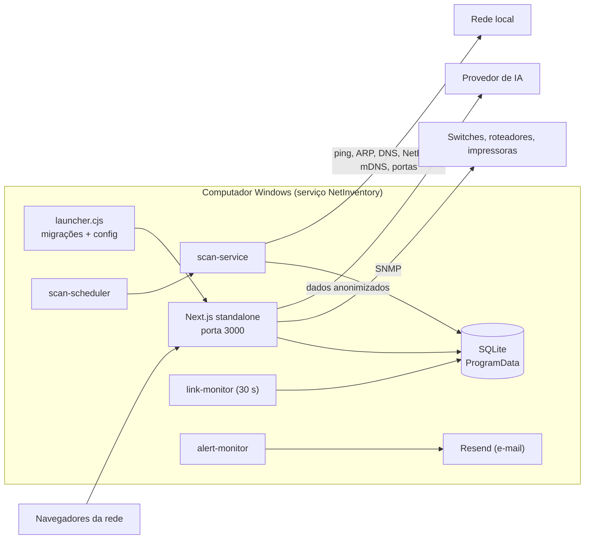

<p align="center">
  
</p>

<h1 align="center">NetInventory</h1>

<p align="center">
  <strong>Inventário, mapa e monitoramento da rede local, com um assistente de IA que entende a sua rede.</strong><br>
  Gratuito, em português e instalado em 1 minuto no Windows.
</p>

<p align="center">
  <a href="https://github.com/CFSJCODE/net-inventory-ia/releases/latest"></a>
  <a href="https://github.com/CFSJCODE/net-inventory-ia/releases"></a>
  <a href="https://github.com/CFSJCODE/net-inventory-ia/actions/workflows/release.yml"></a>
  <a href="https://github.com/CFSJCODE/net-inventory-ia/commits/main"></a>
  <a href="LICENSE"></a>
</p>

<p align="center">
  
  
  
  
  
  
  
  
  
  
</p>

<p align="center"><em>Local network inventory, topology map, SNMP equipment and link monitoring with an AI assistant — free and open source.</em></p>

> **Sobre este repositório:** Este projeto ([`CFSJCODE/net-inventory-ia`](https://github.com/CFSJCODE/net-inventory-ia)) é uma versão amplamente modificada e expandida por **[Cláudio Francisco Dos Santos Júnior (@CFSJCODE)](https://github.com/CFSJCODE)** a partir do repositório original [`douglaspiero/net-inventory-ia`](https://github.com/douglaspiero/net-inventory-ia), criado por **[Douglas Piero](https://www.linkedin.com/in/douglaspiero/)** sob a [Licença MIT](LICENSE). Consulte a seção [Licença e autor](#licença-e-autor) para os créditos obrigatórios e a lista de novas implementações.


## Sumário

- [Download do instalador para Windows (.exe)](#download-do-instalador-para-windows-exe)
- [O que ele faz](#o-que-ele-faz)
- [Modos de uso: local ou servidor](#modos-de-uso-local-ou-servidor)
- [Modo servidor: instalar o host no Ubuntu Server](#modo-servidor-instalar-o-host-no-ubuntu-server)
- [Agente Windows](#agente-windows)
- [Telas e funcionalidades](#telas-e-funcionalidades)
- [A IA trabalhando na administração da rede](#a-ia-trabalhando-na-administração-da-rede)
- [Instalação (Windows)](#instalação-windows)
- [Perfis de acesso](#perfis-de-acesso)
- [Como funciona por dentro](#como-funciona-por-dentro)
- [Desenvolvimento](#desenvolvimento)
- [Gerar e publicar o instalador](#gerar-e-publicar-o-instalador)
- [Limitações conhecidas](#limitações-conhecidas)
- [Licença e autor](#licença-e-autor)

## Download do instalador para Windows (.exe)

O instalador **não fica versionado no Git** (as pastas `installer/output/` e `installer/dist/` estão no `.gitignore`). Ele é gerado pelo workflow [`release.yml`](.github/workflows/release.yml) a cada tag `v*` e publicado como anexo da Release no GitHub.

| Versão atual | Arquivo | Tamanho | SHA-256 |
|---|---|---|---|
| [v0.2.10](https://github.com/CFSJCODE/net-inventory-ia/releases/tag/v0.2.10) | [`NetInventory-Setup-0.2.10.exe`](https://github.com/CFSJCODE/net-inventory-ia/releases/download/v0.2.10/NetInventory-Setup-0.2.10.exe) | 43 MB | `eac8ec36032ef1105dba1aad3b0ade1f0f725af360e2d011ca78aaa92974f383` |

Confira o hash antes de instalar (PowerShell):

```powershell
Get-FileHash .\NetInventory-Setup-0.2.10.exe -Algorithm SHA256
```

Versões anteriores ficam em [Releases](https://github.com/CFSJCODE/net-inventory-ia/releases).

## O que ele faz

O NetInventory roda como serviço em um computador da sua rede e mostra, num painel web acessível de qualquer navegador da rede:

- **Inventário automático**: scans manuais ou agendados (5, 15, 30 ou 60 minutos) descobrem cada dispositivo com IPv4, IPv6, MAC, fabricante, hostname e portas abertas, e classificam o tipo (computador, notebook, celular, impressora, câmera, DVR/NVR, switch, roteador, servidor, Smart TV, IoT).
- **Equipamentos SNMP**: cadastro de switches, roteadores e impressoras gerenciáveis com SNMP v1, v2c ou v3 (MD5/SHA). Mostra CPU, memória, temperatura, ventoinhas, fontes, estado de cada porta e, nas impressoras, os suprimentos (Printer-MIB).
- **Mapa da topologia**: a rede desenhada a partir do gateway, com descoberta de ligações reais via SNMP (tabela de MACs do switch) e posições que você arrasta e ficam salvas.
- **Ligações monitoradas**: cada link importante é testado a cada 30 segundos e só é declarado caído após 2 falhas seguidas; caiu, fica vermelho no mapa e vai para o histórico.
- **Histórico e alertas**: dispositivos novos, mudanças de IP e hostname, quedas e retornos, com notificações no navegador e alertas por e-mail (Resend) para equipamento fora do ar, desempenho degradado e CPU, memória ou temperatura acima do limite.
- **Regras de IP**: classifique endereços por tipo (IP único, faixa, CIDR ou curinga) e ignore IPs que só geram ruído no histórico.
- **Ferramentas de rede**: ARP scan, port scan, SNMP, Wake-on-LAN, DHCP, DNS, tabela ARP, tabela de rotas e auditoria de segurança.
- **Usuários e perfis**: Administrador, Operador e Visualizador, cada pessoa com o acesso certo.

| Topologia | Histórico com resumo da IA |
|---|---|
|  |  |

## Modos de uso: local ou servidor

O NetInventory pode funcionar de dois jeitos. Nos dois, o painel web é o mesmo e cada computador Windows que você quer acompanhar recebe o **agente**, um serviço que coleta sistema operacional, usuário logado, CPU, memória, discos, rede e sensores daquela máquina e envia ao **host**.

| | Modo local (Windows) | Modo servidor (Ubuntu Server) |
|---|---|---|
| Onde roda o host | No próprio PC Windows, junto com o agente | Num Ubuntu Server da rede (máquina física ou VM) |
| Serviços | `NetInventoryDotNetHost` + `NetInventoryDotNetAgent` no Windows | `netinventory-dotnet.service` (systemd) no Ubuntu; `NetInventoryDotNetAgent` em cada Windows |
| Endereço do painel | `http://localhost:3000` | `http://<ip-do-servidor>:3000` (ex.: `http://192.168.0.50:3000`) |
| Destino do agente | `localhost`, porta 3000 | IP do servidor, porta 3000 |
| Indicado para | Uso individual, acompanhar a própria máquina e a rede dela | Vários computadores enviando dados para um ponto central, com o painel aberto em qualquer PC da LAN |
| Configuração do host | Pela página **Servidor › Host** do painel | No terminal do Ubuntu, com `sudo netinventoryctl` |

Como as peças se encaixam no modo servidor:

```text
 PC Windows (agente) ─┐
 PC Windows (agente) ─┼─ HTTP na LAN, porta 3000 ──▶ Ubuntu Server
 PC Windows (agente) ─┘                              ├─ host ASP.NET Core (.NET 10): API dos agentes, contas, páginas "Servidor"
                                                     ├─ motor original Next.js (filho do host, só em 127.0.0.1:3001)
 Navegador de qualquer PC da LAN ──────────────────▶ └─ SQLite em /var/lib/netinventory-dotnet
```

O host .NET serve o painel original (o mesmo visual e as mesmas telas descritas abaixo) e acrescenta o grupo **Servidor** no menu lateral (Agentes, Conexão, Host e Segurança). O motor Node.js do painel roda como processo filho do host, escutando somente em `127.0.0.1:3001`, e os dois usam um único banco SQLite. O scan da rede é feito pelo host, então no modo servidor ele enxerga a rede onde o Ubuntu está.

> **Situação do código:** o host .NET, o agente Windows e os scripts de implantação citados abaixo (pasta `dotnet/`) foram desenvolvidos e testados no PC do autor (Ubuntu Server 24.04 numa VM VirtualBox, IP fixo `192.168.0.50`) e ainda serão enviados a este repositório. Até lá, o instalador publicado em Releases é o do NetInventory original (seção [Instalação (Windows)](#instalação-windows)).

## Modo servidor: instalar o host no Ubuntu Server

### Pré-requisitos

- **Servidor:** Ubuntu Server 24.04 LTS (ou 22.04) x64 com systemd, na mesma rede dos PCs. 2 vCPU, 4 GB de RAM e 25 GB de disco bastam. Numa VM, use a placa de rede em modo **Bridge** para o servidor ter IP próprio na LAN.
- **Pacotes no Ubuntu:** `iputils-ping` e `net-tools` (o scan usa `ping` e `arp`), `openssl`, `curl`, `xz-utils`, `npm`, `sqlite3` e `ufw`.
- **Runtimes:** o host é publicado *self-contained* (traz o runtime .NET 10 junto), então o Ubuntu **não precisa do .NET instalado**. O Node.js 24 do motor também é baixado e conferido pelo script de empacotamento. O **SDK .NET 10** só é necessário no Windows onde o pacote é compilado.

### 1. IP fixo no servidor

Confira o nome da placa com `ip a` e edite o arquivo em `/etc/netplan/` (exemplo para `192.168.0.50`, gateway `192.168.0.1`):

```yaml
network:
  version: 2
  ethernets:
    enp0s3:
      dhcp4: false
      addresses: [192.168.0.50/24]
      routes:
        - to: default
          via: 192.168.0.1
      nameservers:
        addresses: [192.168.0.1, 1.1.1.1]
```

```bash
sudo netplan apply
sudo apt update
sudo apt install -y iputils-ping net-tools sqlite3 curl xz-utils npm openssl ufw
```

### 2. No Windows: preparar os arquivos

Na pasta `dotnet` do repositório, publique o host para Linux:

```powershell
dotnet publish .\src\NetInventory.Server.Host\NetInventory.Server.Host.csproj -c Release -r linux-x64 --self-contained true -o D:\migracao\linux-x64-host
Copy-Item .\deploy D:\migracao\deploy -Recurse
New-Item -ItemType Directory D:\migracao\NetInventory-windows, D:\migracao\dados
tar -cf D:\migracao\NetInventory-windows\motor.tar -C "C:\Program Files\NetInventory" app prisma
```

O `motor.tar` leva o painel original já instalado no Windows. Para levar também o inventário existente, copie o banco e o `config.json` **com o host parado** (PowerShell como administrador; não pode haver `netinventory.db-wal` ao lado do banco):

```powershell
Copy-Item C:\ProgramData\NetInventoryDotNet\data\server\netinventory.db D:\migracao\dados\
Copy-Item C:\ProgramData\NetInventoryDotNet\data\server\config.json D:\migracao\dados\
scp -r D:\migracao usuario@192.168.0.50:~/
```

### 3. No Ubuntu: empacotar o motor e instalar

```bash
cd ~/migracao
mkdir -p NetInventory-windows/extraido && tar -xf NetInventory-windows/motor.tar -C NetInventory-windows/extraido
bash deploy/package-linux-engine.sh --source NetInventory-windows/extraido --output ~/netinventory-engine
sudo bash deploy/install-linux.sh --package ~/migracao/linux-x64-host --engine ~/netinventory-engine --import-data ~/migracao/dados --port 3000 --start
```

O `package-linux-engine.sh` mantém o JavaScript do painel intacto e acrescenta as bibliotecas nativas Linux (engine Prisma da mesma versão, `sharp`) e o Node.js oficial com SHA-256 conferido. Ele precisa de internet só durante essa etapa.

Opções do `install-linux.sh`:

| Opção | O que faz |
|---|---|
| `--package <pasta>` | Pacote `linux-x64` publicado no passo 2 (obrigatório) |
| `--engine <pasta>` | Motor preparado pelo `package-linux-engine.sh`; sem ele o host sobe só com as páginas .NET |
| `--import-data <pasta>` | Pasta com `netinventory.db` e `config.json`; copiados só se o servidor ainda não tiver banco |
| `--port <número>` | Porta do painel e dos agentes (padrão 3000; aceita 1024–65535, exceto 3001) |
| `--start` | Habilita e inicia o serviço ao final |
| `--https-proxy` | Prende o host em `127.0.0.1:7444` para ficar atrás de um Nginx com HTTPS |

O instalador cria o usuário de serviço `netinventory-dotnet` e o serviço `netinventory-dotnet.service` (`Type=notify`, reinício automático em falha), e instala o comando `netinventoryctl`. Os caminhos ficam assim:

| Caminho | Conteúdo |
|---|---|
| `/opt/netinventory-dotnet` | Host .NET |
| `/opt/netinventory-engine` | Motor do painel original |
| `/var/lib/netinventory-dotnet` | Banco, `config.json` e chaves |
| `/etc/netinventory-dotnet/backend.env` | Configuração do serviço (modo 0600) |
| `/var/backups/netinventory-dotnet` | Backups gerados pelo `netinventoryctl backup` |

Sem banco importado, a conta inicial é `admin` e a senha fica em `/etc/netinventory-dotnet/console-bootstrap-password.txt`. Com banco importado, as contas mantêm as senhas.

### 4. Configurar com `netinventoryctl`

Toda a configuração do host é feita no terminal do próprio servidor. O painel só mostra a configuração em vigor (em **Servidor › Host**) e não altera o servidor.

```bash
sudo netinventoryctl set address 192.168.0.50     # IP que a página Host mostra aos agentes
sudo netinventoryctl firewall 192.168.0.0/24      # libera a porta no ufw só para a sua rede
sudo netinventoryctl apply                        # reinicia o serviço e espera o /health
sudo netinventoryctl status
```

O `status` deve mostrar `Porta: 3000`, `Exposicao: lan`, `Agentes na LAN: http://192.168.0.50:3000/` e `Health: respondendo`.

| Comando | O que faz |
|---|---|
| `status` | Estado do serviço, endereços para os agentes e resposta do `/health` |
| `show` | Configuração de rede atual (sem credenciais) |
| `set port <1024-65535>` | Porta do painel e dos agentes |
| `set exposure lan\|proxy` | `lan`: todas as interfaces; `proxy`: só `127.0.0.1`, atrás do Nginx |
| `set lan-http on\|off` | Aceita HTTP vindo de IPs privados da LAN |
| `set address <ip\|->` | IPv4 privado anunciado aos agentes (`-` remove) |
| `set public-url <https://...\|->` | URL pública HTTPS do proxy reverso |
| `apply` | Aplica as mudanças de `set` (reinicia e aguarda o `/health`) |
| `invite [rótulo] [minutos] [id-do-agente]` | Gera um convite de uso único para cadastrar um agente |
| `logs [-f]` | Log do serviço (`journalctl`) |
| `backup [pasta]` | Cópia consistente dos bancos, `config.json` e chaves |
| `firewall [rede/cidr]` | Libera a porta no `ufw` para a rede (padrão `192.168.0.0/16`) |

Para backup diário às 2h: `sudo crontab -e` e acrescente `0 2 * * * /usr/local/sbin/netinventoryctl backup`.

### 5. Abrir o painel e gerar convites

De qualquer PC da rede, abra `http://192.168.0.50:3000/` (troque pelo IP do seu servidor).

Cada agente se cadastra com um **convite** de uso único e prazo curto; a senha do administrador nunca vai para os agentes. Gere o convite de um destes jeitos:

```bash
sudo netinventoryctl invite pc-financeiro 30          # PC novo, convite válido por 30 minutos
sudo netinventoryctl invite 4600G 30 <id-do-agente>   # recadastro de um agente que veio no banco migrado
```

Ou pelo painel, em **Servidor › Agentes**: gere um convite para um PC novo, ou **Recadastrar** na linha de um agente que já existia no banco importado (o convite comum é recusado para um agente já existente, para que um PC não assuma a identidade de outro).

## Agente Windows

### Instalar

1. Baixe o `NetInventory-Agente-Setup.exe` (cerca de 160 MB, *self-contained*: não precisa instalar .NET). Enquanto ele não estiver anexado às Releases, gere-o na pasta `dotnet` com `.\scripts\Build-AgentSetup.ps1` (saída em `dotnet\.artifacts\setup\`).
2. Execute e aceite o pedido de administrador. A tela **Instalar o NetInventory Agente** pede o destino das coletas:

| Campo | Modo local | Modo servidor |
|---|---|---|
| Destino | Host neste computador · `http://localhost:3000` | Host em outro computador da rede |
| Endereço do host | — | IP do servidor, ex.: `192.168.0.50` |
| Porta | 3000 | 3000 |
| Usar HTTPS | Não | Não na LAN; obrigatório fora dela |
| Convite de cadastro | Gerado no painel local | Gerado no servidor (`netinventoryctl invite` ou Servidor › Agentes) |

3. Use **Testar conexão** para confirmar que o host responde e clique em **Instalar**.

O instalador registra o serviço `NetInventoryDotNetAgent` com início automático, instala o aplicativo em `C:\Program Files\NetInventoryDotNet\desktop` e cria atalhos na Área de Trabalho e no Menu Iniciar. A coleta começa na hora, a cada 30 segundos, e em até 30 segundos o PC aparece em **Servidor › Agentes** no painel.

### Depois de instalado

- O aplicativo **NetInventory Agente** mostra o que está sendo coletado neste PC (visão geral, hardware e sensores, armazenamento, rede, sessões, comunicação com o host e configurações). Fechar a janela não para a coleta: quem coleta e envia é o serviço.
- Para trocar o host ou recadastrar, execute o instalador de novo e escolha **Manter o destino atual** ou outro destino, com um convite novo.
- Se o host ficar fora do ar, o agente guarda as coletas numa fila e reenvia quando ele voltar; ele não cria um inventário local paralelo.
- HTTP só é aceito para IPv4 privado (10.x, 172.16–31.x, 192.168.x). Fora da rede local, use HTTPS com certificado válido ou uma VPN; nunca abra a porta 3000 no roteador.
- Para remover: **Configurações › Aplicativos › NetInventory Agente**. A identidade e a fila ficam em `C:\ProgramData\NetInventoryDotNet` para uma reinstalação manter o mesmo cadastro.

## Telas e funcionalidades

| Tela | Rota | O que faz | Implementação |
|---|---|---|---|
| Inventário | `/` | Lista, filtra e ordena os dispositivos; dispara o scan; identificação em lote com IA | `src/components/device-inventory.tsx`, `device-table.tsx`, `device-filters.tsx` |
| Dispositivo | `/devices/[id]` | Detalhes, portas, identidade (nome, tipo, uplink) e diagnóstico de segurança com IA | `src/components/device-identity-card.tsx`, `ai/device-security-card.tsx` |
| Equipamentos | `/equipment` | Cadastro SNMP e leitura automática no intervalo escolhido | `src/components/equipment/`, `src/lib/network/equipment-status.ts` |
| Detalhe do equipamento | `/equipment/[id]` | Hardware, portas em tempo real e suprimentos de impressora | `equipment-status-panel.tsx`, `port-popover.tsx` |
| Topologia | `/topology` | Mapa arrastável com ligações descobertas ou presumidas | `src/components/topology/topology-view.tsx`, `src/lib/topology-layout.ts` |
| Ligações | `/topology/links` | Links monitorados, latência e estado | `topology/links-panel.tsx`, `src/lib/network/link-monitor.ts` |
| Histórico | `/history` | Linha do tempo de eventos com resumo de 24 h ou 7 dias pela IA | `ai/ai-summary-card.tsx`, modelo `DeviceEvent` |
| Assistente | `/assistant` | Chat em português que consulta inventário, histórico e ligações | `ai/assistant-chat.tsx`, `src/lib/ai/features.ts` |
| Ferramentas | `/tools` | ARP scan, port scan, SNMP, WoL, DHCP, DNS, ARP, rotas e auditoria | `src/components/tools/`, `src/lib/network/tools/` |
| Configurações | `/settings` | Faixa e agenda do scan, regras e IPs ignorados, IA, e-mails de alerta, limpeza | `settings-form.tsx`, `ip-rules-card.tsx`, `ignored-ips-card.tsx`, `email-alerts-card.tsx` |
| Usuários | `/users` | Criar, desativar, mudar perfil e redefinir senha | `src/components/users/users-manager.tsx` |
| Minha conta | `/account` | Troca da própria senha | `account/change-password-card.tsx` |

## A IA trabalhando na administração da rede

A IA é opcional e configurada pela interface, em **Configurações**. Provedores suportados ([`src/lib/ai/providers.ts`](src/lib/ai/providers.ts)):

| Provedor | Observação |
|---|---|
| Google Gemini | Modelos gratuitos pelo Google AI Studio |
| OpenRouter | Modelos `:free` (Llama, DeepSeek, Qwen, Gemini) |
| Groq | Llama 3 com resposta muito rápida |
| Ollama | IA local, sem internet e sem chave |
| OpenAI | GPT-4o Mini, GPT-4o e família GPT-5 |
| Personalizado | Qualquer servidor compatível com a API da OpenAI (LM Studio, LocalAI, vLLM…) |

Com ela, o NetInventory ganha um analista de rede:

- **Assistente em português**: "o que entrou na rede nas últimas 24 horas?", "quais dispositivos têm portas arriscadas?". Ele consulta inventário, histórico e ligações (function calling) antes de responder.
- **Identificação de dispositivos**: sugere nome e tipo para aparelhos desconhecidos a partir de fabricante, portas e tipo de MAC, com o nível de confiança.
- **Diagnóstico de segurança**: transforma as portas de risco da rede inteira num relatório priorizado com as ações a tomar.
- **Resumo de eventos**: as últimas 24 horas ou 7 dias em poucas linhas.

| Assistente | Identificação com IA |
|---|---|
|  |  |

**Privacidade:** IPs, MACs, hostnames e apelidos são substituídos por marcadores (`ip-1`, `dispositivo-1`…) **antes** de qualquer envio e restaurados na resposta ([`src/lib/ai/redact.ts`](src/lib/ai/redact.ts)). As chamadas só acontecem quando você clica e as respostas ficam em cache por 24 h ([`src/lib/ai/client.ts`](src/lib/ai/client.ts)). A chave fica criptografada (AES-256-GCM) no banco e nunca volta ao navegador.

## Instalação (Windows)

1. Baixe o instalador em **[Releases](https://github.com/CFSJCODE/net-inventory-ia/releases/latest)** e confira o SHA-256 publicado.
2. Execute num computador que fique ligado e esteja na rede que será monitorada. Sem assinatura digital, o Windows mostra o aviso do SmartScreen: **Mais informações → Executar assim mesmo**.
3. Abra `http://localhost:3000` (ou `http://IP-do-computador:3000` de outra máquina) e crie o administrador.
4. Em **Configurações → Scan da rede**, informe a faixa da sua rede. Descubra com `ipconfig`: IPv4 `192.168.0.25` e máscara `255.255.255.0` resultam em `192.168.0.0/24`.
5. Opcional: configure um provedor de IA quando o app pedir (ou em Configurações).

O instalador traz tudo embutido (Node.js, banco SQLite, migrações), registra o serviço **NetInventory** (inicia com o Windows e reinicia sozinho), cria atalhos no menu Iniciar e libera a porta 3000 no firewall para redes privadas e de domínio. Os dados ficam em `C:\ProgramData\NetInventory` (banco `netinventory.db`, `config.json` e logs) e são mantidos em atualizações.

**Atualizar:** execute o instalador da versão nova por cima da instalada.

## Perfis de acesso

| | Administrador | Operador | Visualizador |
|---|:-:|:-:|:-:|
| Ver inventário, mapa, ligações e histórico | ✓ | ✓ | ✓ |
| Rodar scan, ferramentas e testar ligações | ✓ | ✓ | |
| Editar dispositivos, ligações e o mapa | ✓ | ✓ | |
| Usar os recursos de IA | ✓ | ✓ | |
| Configurações (scan, IA, e-mails, limpeza) | ✓ | | |
| Gerenciar usuários | ✓ | | |

As permissões são checadas no servidor em cada ação ([`src/lib/auth/permissions.ts`](src/lib/auth/permissions.ts)). Desativar um usuário ou redefinir a senha dele encerra as sessões abertas na hora, e o sistema nunca fica sem um administrador ativo.

## Como funciona por dentro



### Descoberta de rede

Módulo em `src/lib/network/`:

1. **`subnet.ts`**: expande o CIDR configurado na lista de IPs (limite de 4096 endereços por scan).
2. **`ping.ts`**: ping sweep concorrente para descobrir hosts ativos.
3. **`arp.ts`**: lê a tabela ARP do sistema para obter os MACs.
4. **`dns.ts`** e **`mdns.ts`**: hostname por DNS reverso, NetBIOS (`nbtstat`, no Windows) e mDNS.
5. **`oui-data.ts`** + **`vendor-lookup.ts`**: fabricante pelo MAC, com tabela local primeiro e, se faltar, a API gratuita [macvendors.com](https://macvendors.com) (uma requisição por vez, com cache).
6. **`port-scan.ts`**: portas TCP comuns (22, 80, 443, 445, 3389, 631, 9100…).
7. **`classify.ts`** + **`ip-rules.ts`**: tipo pela heurística de fabricante, hostname e portas, ou pela regra de IP que você definiu.
8. **`ignored-ips.ts`**: descarta os IPs ignorados antes de gravar.

O resultado é persistido por `src/lib/scan-service.ts`, que compara com o estado anterior e registra em `DeviceEvent` cada novo dispositivo, mudança de IP/hostname ou transição online/offline.

### Equipamentos SNMP e alertas

- `src/lib/network/equipment-status.ts` lê MIBs padrão (IF-MIB, Printer-MIB) e a HH3C (CPU, memória, temperatura, ventoinhas e fontes, testada no HP V1910-24G). A tabela de MACs do switch (`switch-fdb.ts`) alimenta a topologia real.
- Usuário e senha SNMPv3 ficam criptografados no banco.
- `src/lib/alerts/rules.ts` é uma máquina de estados pura: só alerta depois de algumas checagens seguidas com problema e respeita um intervalo mínimo entre e-mails, para um pico isolado não virar alerta. Os e-mails passam por uma fila guardada no banco (`alert-monitor.ts`).

### Banco de dados

Prisma com SQLite ([`prisma/schema.prisma`](prisma/schema.prisma)). Modelos: `Device`, `DeviceEvent`, `ScanConfig`, `ScanRun`, `TopologyLink`, `MapPosition`, `User`, `AiCache`, `AiSummary`, `AppSetting` e `Equipment`. No app instalado, o `launcher.cjs` aplica as migrações com `node:sqlite`, compatível com a tabela `_prisma_migrations` do Prisma.

## Desenvolvimento

Requisitos: Node.js 22 ou mais novo (testado no 24) e Windows (os scans usam `ping`, `arp` e `nbtstat` do sistema; partes funcionam em Linux).

```bash
npm install
cp config/env.example .env          # Bash/Git Bash; no PowerShell use: Copy-Item config/env.example .env
# preencha AUTH_SECRET (o comando para gerar está no arquivo)
npx prisma migrate dev        # cria o banco SQLite local (prisma/dev.db)
npm run dev                   # http://localhost:3000
```

| Comando | O que faz |
|---|---|
| `npm test` | Testes (Vitest) |
| `npm run lint` | ESLint |
| `npm run build` | Build de produção do Next |
| `npm run build:installer` | Gera `installer/output/NetInventory-Setup-<versão>.exe` |
| `npm run site` | Serve o site de apresentação (`site/`) em `http://localhost:8080` |

### Stack

- **Next.js 15** (App Router, Server Actions), **React 19**, **TypeScript**, **Tailwind CSS v4**, shadcn/ui, TanStack Query, Zustand
- **Prisma** + **SQLite**
- **net-snmp** para SNMP v1/v2c/v3
- SDK `openai` usado com qualquer provedor compatível (Structured Outputs e function calling)
- **Resend** para os e-mails de alerta
- Instalador: build standalone + Node embutido + [WinSW](https://github.com/winsw/winsw) + [Inno Setup 6](https://jrsoftware.org/isinfo.php)

## Gerar e publicar o instalador

### Localmente (Windows)

```powershell
winget install JRSoftware.InnoSetup
npm ci
npx prisma generate
npm run build:installer
```

O [`installer/build.mjs`](installer/build.mjs) faz o build *standalone* do Next numa pasta separada (`.next-installer`, sem conflitar com o `next dev`), embute o `node.exe` (com hash conferido) e o WinSW para o serviço, e compila [`installer/netinventory.iss`](installer/netinventory.iss). A versão vem do `package.json`.

### Pelo GitHub Actions

1. Atualize `version` no `package.json` e faça o merge no `main`.
2. Crie e envie a tag: `git tag v0.2.11 && git push origin v0.2.11`.
3. O workflow [`release.yml`](.github/workflows/release.yml) roda em `windows-latest`: instala o Inno Setup, executa os testes, gera o `.exe` e o anexa à Release com notas automáticas. Também pode ser disparado manualmente (`workflow_dispatch`).

Também é possível criar um workflow semelhante para o host .NET e o agente: compilar o `NetInventory-Agente-Setup.exe` (e o pacote `linux-x64` do host) num runner do GitHub e anexar a pasta gerada em `.zip` à Release, para que o guia acima comece direto pelo download.

Para atualizar um serviço já instalado com um build local, sem gerar instalador, há os scripts em [`scripts/windows/`](scripts/windows/) (`update.bat` pede privilégio de administrador e chama `update-service.ps1`).

## Limitações conhecidas

- O instalador original é só para Windows; o host em Linux usa o [modo servidor](#modo-servidor-instalar-o-host-no-ubuntu-server). O painel é servido em HTTP na rede local (não exponha a porta 3000 para a internet).
- O instalador não tem assinatura digital, por isso o aviso do SmartScreen.
- Alertas no navegador e por e-mail; ainda sem Telegram ou WhatsApp e sem exportação do inventário.
- No painel original, sistema operacional e usuário logado só aparecem para os PCs com o [agente Windows](#agente-windows).
- A classificação de tipo é heurística; a topologia sem SNMP mostra ligações presumidas ao gateway.

Sugestões e contribuições são bem-vindas: abra uma [issue](https://github.com/CFSJCODE/net-inventory-ia/issues). Para falhas de segurança, veja o [SECURITY.md](.github/SECURITY.md).

## Licença e autor

Distribuído sob a licença **[MIT](LICENSE)**, mantendo integralmente a licença e os avisos obrigatórios de direitos autorais exigidos pelo autor original:

- **Projeto e base original ([`douglaspiero/net-inventory-ia`](https://github.com/douglaspiero/net-inventory-ia)):** [MIT](LICENSE) © 2026 **[Douglas Piero](https://www.linkedin.com/in/douglaspiero/)**, criador e desenvolvedor original do NetInventory.
- **Amplas modificações, expansões e implementação de novos recursos ([`CFSJCODE/net-inventory-ia`](https://github.com/CFSJCODE/net-inventory-ia)):** [MIT](LICENSE) © 2026 **[Cláudio Francisco Dos Santos Júnior (@CFSJCODE)](https://github.com/CFSJCODE)** — responsável por todas as adições, evoluções arquiteturais e implementações de novos recursos neste repositório.

### Adições e novos recursos implementados por Cláudio (@CFSJCODE)

Sobre a base original do projeto, todas as ampliações e novas funcionalidades deste repositório foram desenvolvidas e implementadas por **[Cláudio Francisco Dos Santos Júnior (@CFSJCODE)](https://github.com/CFSJCODE)**, incluindo:

- **Modo Servidor (Ubuntu Server) e Agente Windows (.NET 10):** host `ASP.NET Core` (`netinventory-dotnet.service` e CLI `netinventoryctl`) com suporte a Linux e Windows, e agente instalável para Windows (`NetInventoryDotNetAgent` + aplicativo desktop) com coleta contínua de SO, usuário logado, hardware, sensores, armazenamento, rede e sessões via convite de uso único.
- **Módulo de Equipamentos SNMP (`/equipment` e `/equipment/[id]`):** cadastro e monitoramento de switches, roteadores e impressoras gerenciáveis com SNMP v1, v2c e v3 (`authNoPriv` MD5/SHA com credenciais criptografadas), leitura automática agendada, métricas de hardware (CPU, memória, temperatura, ventoinhas e fontes via MIBs padrão e HH3C), painel de portas em tempo real com detalhes por porta e níveis de suprimentos de impressoras (Printer-MIB).
- **Topologia real via SNMP e mapeamento de portas:** posicionamento automático de dispositivos, switches e clientes Wi-Fi/APs pela tabela FDB/MAC do switch, exibição da porta do switch nos rótulos das ligações com dicas detalhadas, vínculo manual *"Conectado a"* e identificação de *"esta máquina"* por MAC em hosts com múltiplas interfaces.
- **Alertas por e-mail (Resend):** monitoramento ativo com máquina de estados, confirmação por leituras seguidas, intervalo mínimo entre avisos (*cooldown*), fila persistente no banco, alertas de queda/degradação e limites de CPU, memória e temperatura, notificações de recuperação e envio de e-mail de teste.
- **IA multi-provedor:** suporte a Google Gemini, OpenRouter, Groq, Ollama e servidores compatíveis com a API da OpenAI (além do suporte original à OpenAI), com melhorias nos prompts de classificação.
- **Evoluções no Scan e no Inventário:** continuidade de cadastro pelo endereço MAC (preservando histórico, apelido e vínculos ao mudar de IP e mesclando duplicados), detecção de hosts que bloqueiam ping via sondagem TCP (*TCP liveness probe*), descoberta por mDNS e resolução aprimorada de hostnames no Windows, categorias `SMART_TV`, `IOT` e `DVR/NVR`, regras de classificação por IP, bloqueio de tipo individual/em lote, lista de IPs ignorados e prévia ao vivo da faixa CIDR.
- **Automação de Build, Release e Atualização:** workflow de GitHub Actions ([`release.yml`](.github/workflows/release.yml)) para compilação e publicação automática do instalador `.exe` (Inno Setup) com hash SHA-256 nas Releases, encerramento automático de processos antigos durante o upgrade e scripts de atualização rápida do serviço local ([`scripts/windows/`](scripts/windows/)).

## Estrutura do projeto

Consulte o [índice da documentação](docs/README.md), o [mapa da estrutura do repositório](docs/REPOSITORY-STRUCTURE.md), o [índice das configurações](config/README.md) e a pasta de [instruções para agentes de IA](agents_ia/README.md). Para a política de segurança, consulte `.github/SECURITY.md`.
